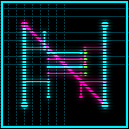

# Neon Grid: Cyber Server Tycoon



A cyberpunk server-management tycoon game. You are a netrunner/sysadmin in a
neon-drenched megacity: start with a rented basement rack, run courier/storage/
hosting contracts, upgrade hardware, research a 50+ node tech tree, and perform
turn-based **netruns** to hack, loot, and claim abandoned servers. Manage power,
cooling, dust, heat (the law is watching), employees, and cyberware while you
build a distributed server empire.

Built with **C++20, CMake, SDL2, Dear ImGui (docking), Lua 5.4 (sol2),
nlohmann/json, libcurl, miniz, spdlog** — no game engine.

## Download & Play (Windows)

Grab **`CyberServerTycoonSetup.exe`** from the
[latest release](https://github.com/Cilis1/Neon-Grid-Cyber-Server-Tycoon/releases/latest).
Run it: it downloads the full game (`game.zip`) from the release, verifies the
SHA-256, installs to `%LOCALAPPDATA%\NeonGrid\game\`, creates a desktop shortcut
with the neon icon, and launches the game. Re-running the setup updates the
game to the latest release automatically.

## Features

- **Server room simulation** — 16×12 tile grid, racks with U-slots, servers with
  CPU/RAM/storage/PSU/fan/NIC/GPU slots, PDUs, UPS, coolers, switches, bezier
  power/net cables you place yourself, dust & wear, temperature model, breaker
  trips, room expansions.
- **Netrunning** — turn-based grid intrusions vs. patrolling ICE, detection and
  trace meters, 10 data-driven programs (Lua-scriptable), proxies, claiming
  abandoned servers for passive income.
- **Economy** — courier route minigame, storage/hosting SLAs with uptime tracking,
  crypto mining with fluctuating prices, data brokering, botnets, daily power/rent
  bills, 5 factions with reputation.
- **Tech tree** — 54 nodes across 6 branches (Hardware, Software, Netrunning,
  Economy, Stealth, Infrastructure) with prereqs, credits + RP costs, and a
  data-driven effect system.
- **Heat & events** — heat thresholds from scans to raids, 16 random events
  (some Lua-driven), bribes.
- **Employees & cyberware** — hire maintenance/netrunner/manager/security staff;
  install Neural Link, Reflex Tuner, ICE Breaker, Ghost Protocol, Dermal Plating.
- **Persistence** — JSON saves with versioning/migrations, autosave every in-game
  day at `%LOCALAPPDATA%\NeonGrid\saves\savegame.json`.

## Build from source (Windows)

Requires CMake ≥ 3.24, Visual Studio 2026 (MSVC; `cmake --preset windows-msvc`), Python 3 + Pillow (for the icon).
All third-party dependencies are fetched automatically via `FetchContent` — no
manual installs.

```bat
python scripts/generate_icon.py        # if assets/icon/icon.ico is missing
python scripts/download_fonts.py       # optional (game falls back to default font)
cmake --preset windows-msvc
cmake --build --preset windows-msvc-release
ctest --test-dir build/windows-msvc -C Release --output-on-failure
```

Run the game: `build\windows-msvc\Release\NeonGrid.exe`
Run the bootstrapper: `build\windows-msvc\Release\CyberServerTycoonSetup.exe`

See [docs/BUILDING.md](docs/BUILDING.md) for details and troubleshooting.

## Controls

| Key | Action |
| --- | --- |
| Mouse | everything (click/drag) |
| F1 | help overlay |
| F11 | fullscreen toggle |
| ESC | save & back to main menu |
| Top-right `\|\| 1x 2x 4x` | simulation speed (1 real second = 1 in-game minute at 1x) |

## Project layout

```
src/            C++20 sources (core, hardware, netrunning, economy, techtree, net, ui, utils)
data/           JSON game data (tech tree, hardware, contracts, factions, market, programs, events)
assets/         icon (generated), fonts (downloaded), optional textures/sounds
scripts/        generate_icon.py, download_fonts.py, pack_assets.py, lua/ event & program scripts
installer/      CyberServerTycoonSetup bootstrap (curl + miniz + COM shortcut)
tests/          Catch2 unit + integration tests
.github/workflows/build-release.yml   CI: build, test, package, release on v* tags
docs/           design, tech stack, building, installer, JSON schemas
```

## How the bootstrap installer works

`CyberServerTycoonSetup.exe` (under 5 MB, static libcurl + miniz):

1. Fetches `version.json` from `…/releases/latest/download/version.json`.
2. Compares with `%LOCALAPPDATA%\NeonGrid\version.txt`; downloads `game.zip` if
   newer/missing (with progress + SHA-256 verify, one retry).
3. Extracts to `%LOCALAPPDATA%\NeonGrid\game\` (miniz, zip-slip protected).
4. Creates `Neon Grid - Cyber Server Tycoon.lnk` on the Desktop via COM
   `IShellLink`/`IPersistFile`, with the game icon.
5. Launches `NeonGrid.exe --installed`.

Details: [docs/INSTALLER.md](docs/INSTALLER.md).

## Testing

40 Catch2 tests cover the tech tree, economy, hardware sim, netrunning, save/load
round-trips, installer (SHA-256 + zip), and a 10-in-game-day integration
simulation. CI runs them on every push/PR on `windows-latest`.

## License

MIT — see [LICENSE](LICENSE). Third-party libraries keep their own licenses.
Fonts are SIL OFL (see `assets/fonts/licenses/` when downloaded).
