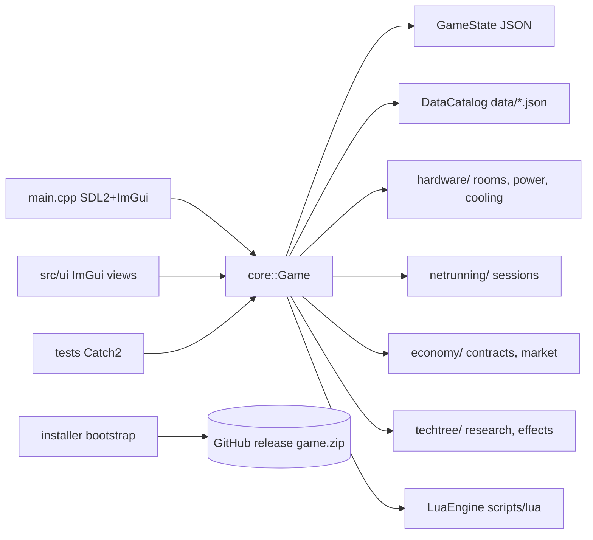

# Tech Stack & Architecture

## Stack

| Layer | Technology |
| --- | --- |
| Language | C++20 |
| Build | CMake ≥ 3.24 + presets, `FetchContent` for all deps |
| Window/input | SDL2 2.30 |
| UI | Dear ImGui (docking branch, 1.93) with SDL2 + SDL_Renderer backends |
| Image/fonts/audio | SDL2_image, SDL2_ttf, SDL2_mixer (DLLs packaged in game.zip) |
| Scripting | Lua 5.4 + sol2 (optional; C++ fallback effect system) |
| Data | nlohmann/json (all game data + saves) |
| Networking | libcurl (installer downloader, in-game version checker) |
| Compression | miniz (installer zip extraction) |
| Logging | spdlog (file + in-game log buffer) |
| Tests | Catch2 v3 (`ctest`) |
| Windows integration | Win32 COM `IShellLink`/`IPersistFile` shortcuts, `.rc` icon embedding |
| Assets | Python 3 + Pillow (icon), download script (OFL fonts) |

## Architecture

```
                 ┌──────────────────────────────┐
                 │  NeonGrid.exe (src/main.cpp) │  SDL2 window, ImGui frame,
                 │  fixed-timestep loop         │  autosave, menu/in-game screens
                 └───────────────┬──────────────┘
                                 │ drives
                 ┌───────────────▼──────────────┐
   ┌──────────── │  neongrid_core (static lib)  │ ────────────┐
   │             │  core::Game orchestrator     │             │
   │             │  - GameState (JSON save)     │             │
   │             │  - DataCatalog (data/*.json) │             │
   │             │  - EventBus, Rng, LuaEngine  │             │
   │             │  hardware/ netrunning/       │             │
   │             │  economy/ techtree/ net/     │             │
   │             └──────────────────────────────┘             │
   │                                                            ▼
   │  src/ui/*  ← ImGui views (ServerRoomView, TechTreeView,   tests/ (Catch2)
   │  NetrunView, ContractView, MarketView, StatusPanel,       link core only
   │  MainMenu, LogWindow)                                      (no SDL/ImGui)
   └────────────────────────────────────────────────────────────┘

   CyberServerTycoonSetup.exe (installer/) — standalone: curl download,
   SHA-256 verify, miniz unzip, COM desktop shortcut, launch.
```

Mermaid:



## Data flow

1. `DataCatalog::load_from_dir(data/)` parses and validates all JSON at startup.
2. `Game::new_game(seed)` builds the starter room via `HardwareFactory`.
3. Each frame, the main loop accumulates real time and calls `Game::tick()` once
   per in-game minute (speed-scaled, max 8 catch-up ticks/frame).
4. `tick()` advances rooms (power/cooling/dust/temp/failures), contracts, heat,
   market, employees, random events, daily/weekly rollovers.
5. UI views render from `GameState` every frame; player actions call `Game`
   methods (buy/install/cable/research/netrun/…).
6. Saves serialize `GameState` to JSON (`version` field + migrations).

## Key classes

| Class | File | Role |
| --- | --- | --- |
| `core::Game` | `src/core/Game.hpp` | orchestrator; all UI/tests go through it |
| `core::GameState` | `src/core/GameState.hpp` | entire serializable state |
| `core::DataCatalog` | `src/core/DataCatalog.hpp` | loads/validates `data/*.json` |
| `hardware::Room` / `Component` | `src/hardware/*` | room grid, components, power/cooling sim |
| `netrunning::NetrunSession` | `src/netrunning/NetrunSession.hpp` | turn-based intrusion |
| `economy::ContractManager` / `Market` | `src/economy/*` | contracts, prices |
| `techtree::TechTree` / `Effect` | `src/techtree/*` | research + data-driven effects |
| `installer::run_bootstrap` | `installer/bootstrap.cpp` | download/install/shortcut/launch |
